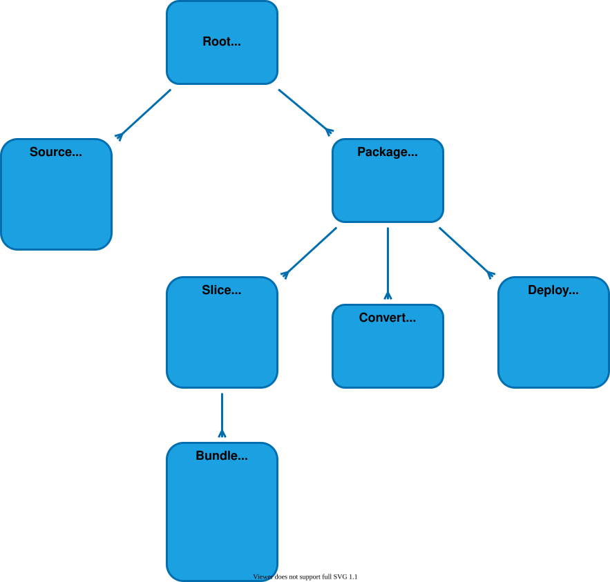

# $mol_build2

## Hierarhy



## Сборка и тесты

```
npx mam mol/build2/0start
node mol/build2/0start/-/node.js <модуль>
```

Тесты лежат рядом с модулями (`5slice`, `6bundle`) и прогоняются при сборке сборщика. Подопытные модули для них в `fixture`.

## Плагины

Типы плагинов: лоадер (`$mol_build2_9source_*`), компайлер (`$mol_build2_8convert_*`), бандлер (`$mol_build2_6bundle_*`).
Реестр — списки `*_classes()` в `$mol_build2_2root`. Свой сборщик — наследник с расширенными списками,
подменённый через контекст до старта:

```typescript
namespace $ {

	export class $my_source_gql extends $mol_build2_9source {
		static match( file: $mol_file ) { return /\.gql$/.test( file.ext() ) }
		// deps() — зависимости файла с приоритетами (0 — максимум)
	}

	export class $my_convert_gql extends $mol_build2_8convert {
		static match( file: $mol_file ) { return /\.gql$/.test( file.ext() ) }
		// generated_sources() — порождённые исходники (попадут к другим лоадерам)
		// generated_artifacts() — готовые файлы для бандлов
	}

	export class $my_root extends $mol_build2_2root {
		override source_classes() { return [ ...super.source_classes(), this.$.$my_source_gql ] }
		override convert_classes() { return [ ...super.convert_classes(), this.$.$my_convert_gql ] }
	}

	$.$mol_build2_2root = $my_root

}
```

Бандлер запрашивает все исходники нужного типа через лоадер-класс: `slice.files_of( $mol_build2_9source_ts )`.

## NPM

```typescript
const doc = $npm[ 'yaml' ].parse( text )
```

Сборщик сам ставит пакет, на вебе собирает его esbuild'ом в самодостаточный чанк
(tree-shaking по реально использованным членам), на ноде отдаёт рантайм-require.
Типы пакетов генерируются в `-web/deps.d.ts` / `-node/deps.d.ts` по факту использования.
